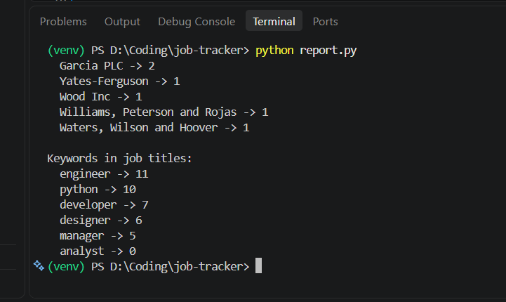

# Job Posting Tracker

A small data pipeline that scrapes job postings, cleans them, stores them in a database, and reports on them with SQL.

## What it does
1. `scraper.py` uses Selenium to load the page, wait for the listings, and collect title, company, location, and date.
2. `cleaner.py` uses pandas to trim text, fix dates, and remove duplicates.
3. `database.py` saves the data to SQLite. A UNIQUE constraint stops the same posting being stored twice.
4. `report.py` and `queries.sql` show total postings, new postings per scrape day, top companies, and keyword counts.

## Data source
https://realpython.github.io/fake-jobs/ is a practice site built for scraping. The data is fake, so the report numbers are not real market insights.

## Notes and limitations
- The page is static, so Beautiful Soup would also work. I used Selenium to learn browser automation.
- The site has one page, so pagination was not needed.
- Keywords come from job titles only, because there are no job descriptions.

## How to run
```
git clone https://github.com/GCAKuma/job-tracker.git
cd job-tracker
python -m venv venv
venv\Scripts\activate
pip install -r requirements.txt
python database.py
python report.py
```
Requires Google Chrome installed.

## Sample output


## Tech
Python, Selenium, pandas, SQLite, SQL

## Next steps
- Move storage to PostgreSQL
- Run the scraper daily with Airflow